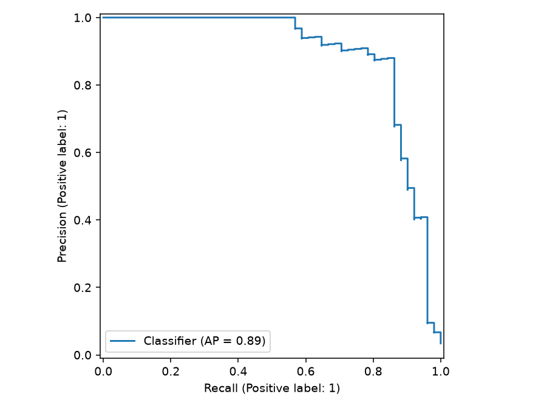
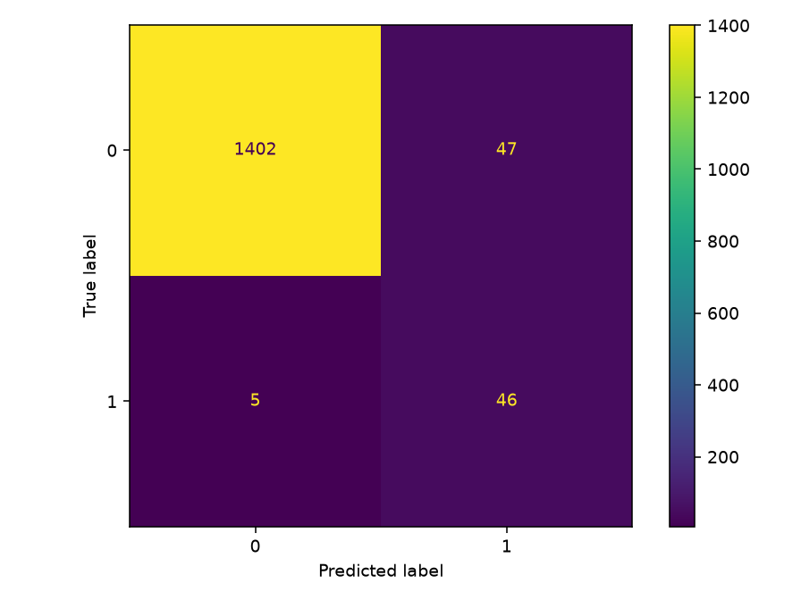
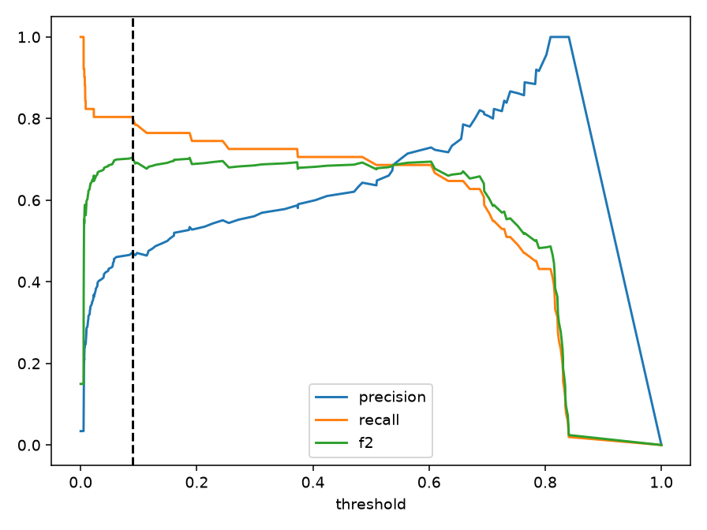
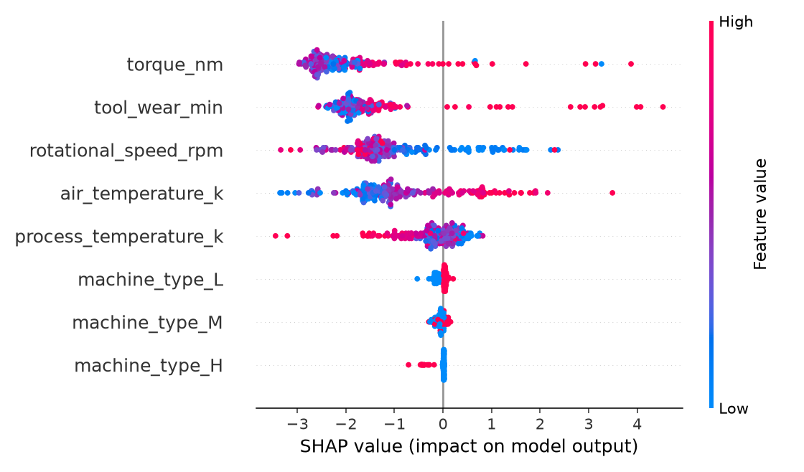
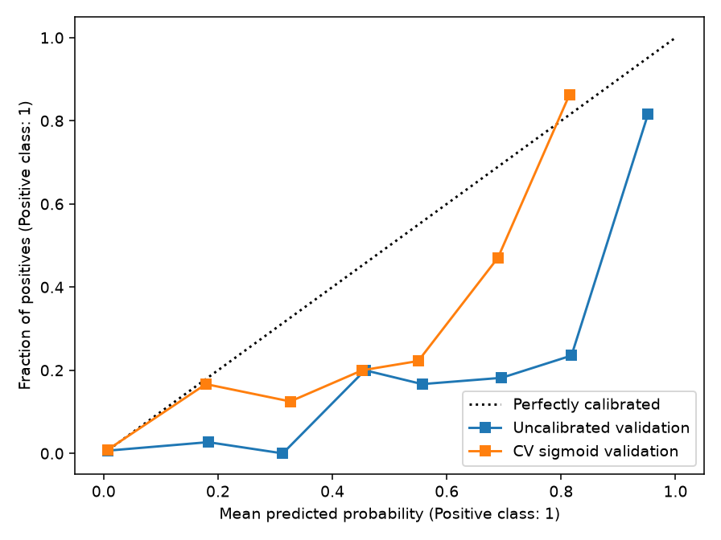
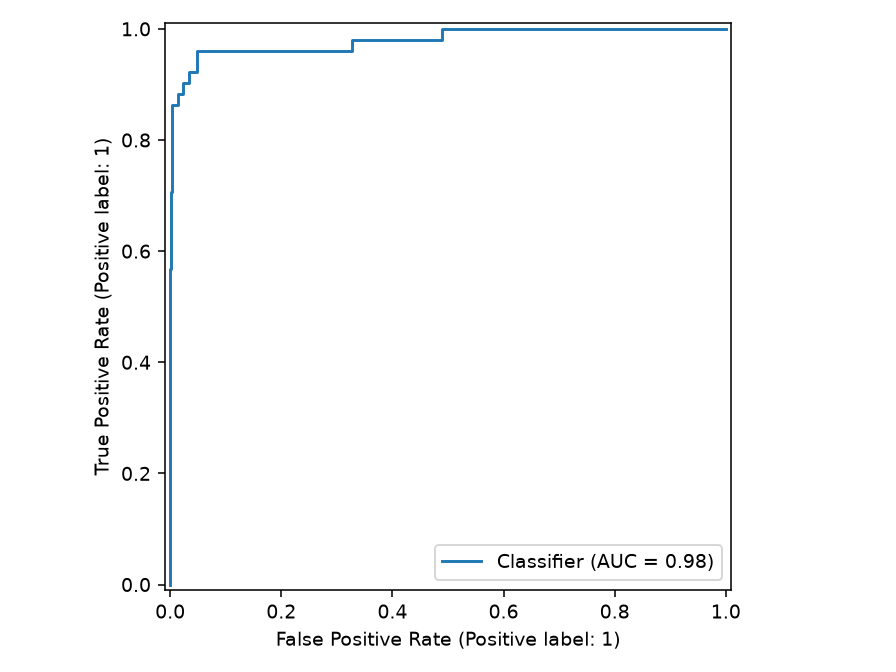
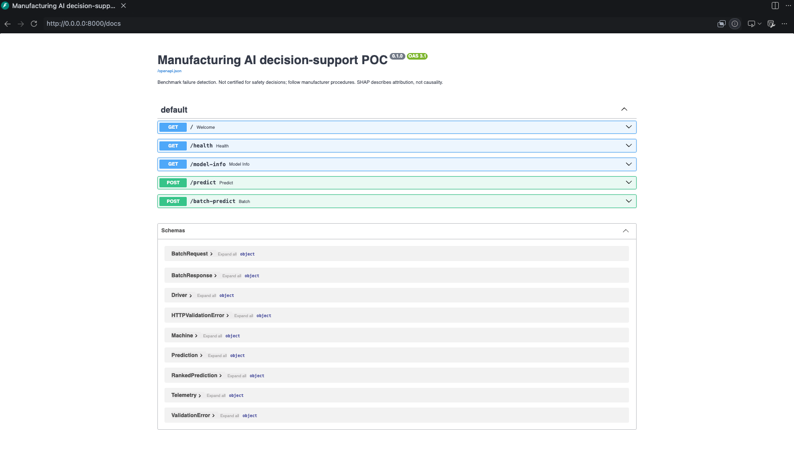

# Manufacturing AI — Predictive Maintenance & Production Risk Intelligence


## Project Overview
A focused Python decision-support POC for reviewing manufacturing equipment telemetry. It compares failure-detection models, explains their outputs, and ranks a fleet for maintenance review through an API. It demonstrates reproducible ML engineering rather than a certified maintenance system.

AI4I labels describe a failure condition in the same record. This project does **not** establish a future failure horizon, remaining useful life, downtime reduction, or industrial safety performance. Manufacturer maintenance procedures, technicians and reliability engineers remain authoritative.

## What the System Does
Raw telemetry → explicit validation → leakage-safe features → four-model comparison → training-only calibration → validation-selected threshold → SHAP attribution → maintenance policy → FastAPI fleet ranking. An optional language model summarizes structured output; all predictive and policy decisions happen before it is called.

## Architecture


## Dataset
[UCI AI4I 2020 Predictive Maintenance Dataset](https://archive.ics.uci.edu/dataset/601/ai4i), DOI [10.24432/C5HS5C](https://doi.org/10.24432/C5HS5C), 2020, licensed CC BY 4.0. UCI describes it as a synthetic industrial benchmark with 10,000 rows and six features. The original CSV is downloaded without modification; its SHA-256 is stored in metadata. See [data/README.md](data/README.md).

Features: type (L/M/H), air and process temperature (K), rotational speed (rpm), torque (Nm), tool wear (min). Target: `Machine failure`. `TWF`, `HDF`, `PWF`, `OSF`, `RNF` encode failure outcomes and are excluded to prevent severe target leakage. `UDI` and `Product ID` are excluded identifiers. An explicit feature allowlist and regression test prevent these columns from entering the model.

Validation reports missing values, prevalence and duplicate identifiers. Invalid targets, nonnumeric/out-of-range values and duplicates fail clearly; records are never silently dropped. Missing numeric values are imputed from training medians, type from the training mode. Missing fields are rejected at the API. Preprocessing is serialized with the estimator.

## ML Methodology
Fixed seed 42; stratified 70/15/15 train/validation/test split. All models use the same split. Dummy prior probabilities establish a sanity baseline; balanced logistic regression is a transparent linear baseline; balanced random forest captures nonlinear interactions; XGBoost uses training-derived `scale_pos_weight`. No oversampling occurs.

XGBoost's small grid search optimizes average precision in three-fold stratified CV **only on training data**, including fold-local imputation and scaling. Quick mode evaluates two depth settings; normal mode additionally varies learning rate, estimator count and minimum child weight. Other candidate settings are fixed. Training runs on one worker for predictable local resource usage.

Model selection maximizes validation average precision; recall then F2 break ties. Candidate validation metrics use each model's own validation F2 threshold and are labeled accordingly. Sigmoid calibration uses training out-of-fold predictions with `ensemble=False`; the calibrated model is retained only if its validation Brier score is no worse than the base model. This avoids wasting the test set on calibration choices. Metadata records both Brier scores and the chosen mode. See the [scikit-learn calibration documentation](https://scikit-learn.org/stable/modules/calibration.html).

The chosen estimator remains trained on the training partition; validation is not added back. All model/calibration/threshold choices are frozen before computing held-out test probabilities once. Reporting at two thresholds uses those same probabilities. `make evaluate` reads the recorded test report rather than fitting, tuning, or consuming the test set again.

## Why Accuracy Is Not Enough
Only about 3.4% of AI4I records are failures, so predicting healthy for every row gives superficially high accuracy. Average precision summarizes precision versus recall across thresholds (it is the sklearn AP definition, not trapezoidal PR integration). Recall measures detected failures; precision measures how many alerts are failures. F2 weights recall more than precision; false-negative rate exposes missed failures. These metrics describe this benchmark and do not establish maintenance economics.

## Threshold Optimization
The operating threshold maximizes validation F2 over every unique validation probability plus 0 and 1. Equal F2 favors precision, then the larger threshold. The test report includes threshold 0.5 and the selected threshold, with confusion matrices, F1, F2, ROC-AUC, AP, precision, recall, false-negative rate and Brier score. No thresholds are tuned against test data.

## Model Explainability
Tree SHAP supports random forest and XGBoost; logistic regression uses linear SHAP; a dummy winner returns zero constant-model contributions. Global summary plots show transformed model features. Local explanations group type indicators into the original type field and return three drivers ranked by absolute contribution, with signed values and units.

**SHAP values describe model attribution, not causal relationships.** Attributions explain the **uncalibrated base estimator**, not the sigmoid calibration mapping. They are not additive to the API's calibrated probability. Random forest attributions use base-model probability output; XGBoost/linear contributions use base-model log odds. Drivers are associations learned from the benchmark, not diagnosed physical failure causes. See the [SHAP TreeExplainer documentation](https://shap.readthedocs.io/en/stable/generated/shap.TreeExplainer.html).

## Results
<!-- RESULTS_START -->
Measured quick-mode run.

Validation comparison (each uncalibrated candidate at its validation F2 threshold):

| Model | AP | Recall | Precision | F1 | F2 |
|---|---:|---:|---:|---:|---:|
| dummy | 0.0340 | 1.0000 | 0.0340 | 0.0658 | 0.1496 |
| logistic_regression | 0.3083 | 0.6667 | 0.2048 | 0.3134 | 0.4595 |
| random_forest | 0.7262 | 0.7647 | 0.6290 | 0.6903 | 0.7331 |
| xgboost | 0.7415 | 0.8039 | 0.4713 | 0.5942 | 0.7045 |

Selected **xgboost**, operating threshold **0.088757**. Final held-out test (1500 rows):

| Metric | At 0.5 | Operational |
|---|---:|---:|
| average_precision | 0.8909 | 0.8909 |
| roc_auc | 0.9799 | 0.9799 |
| recall | 0.8627 | 0.9020 |
| precision | 0.7857 | 0.4946 |
| f1 | 0.8224 | 0.6389 |
| f2 | 0.8462 | 0.7744 |
| false_negative_rate | 0.1373 | 0.0980 |
| brier_score | 0.0105 | 0.0105 |

Test false negatives: 7 at 0.5 versus 5 operational; false positives: 12 versus 47.
The validation-selected threshold is not guaranteed to maximize test F2. Inspect both thresholds; do not retune against this test set.

Calibration retained: True. Validation Brier: 0.02493 raw, 0.01721 calibrated.

Split counts (rows/positive/negative): {'train': {'rows': 7000, 'positive': 237, 'negative': 6763}, 'validation': {'rows': 1500, 'positive': 51, 'negative': 1449}, 'test': {'rows': 1500, 'positive': 51, 'negative': 1449}}.

All results are synthetic UCI benchmark measurements, not validated plant performance.
<!-- RESULTS_END -->

Generated reports include data validation, validation candidate comparison, training CV search results, exact validation threshold table, final test metrics, and six figures: confusion matrix, precision-recall, ROC, validation calibration, threshold analysis and SHAP summary. Resume bullets and interview notes contain only supported claims. Small test fixture metrics are never reported as UCI performance.

### Evaluation figures

These figures were generated from the official UCI dataset run reported above. Test-set plots describe held-out performance; threshold selection and calibration comparisons use validation data.

**Precision–recall curve — held-out test.** Average precision is **0.8909**. This curve shows how alert precision changes as more failures are detected, making it more informative than accuracy for this rare-failure benchmark.



**Confusion matrix — held-out test at the selected threshold.** At threshold **0.088757**, the model detects **46 of 51 failures**, misses **5**, and generates **47 false alerts**. Label `1` means failure; label `0` means non-failure.



**Threshold tradeoff — validation only.** The dashed line marks the validation-selected F2 threshold. Lower thresholds generally favor recall at the expense of precision. This selection is fixed before test evaluation; it does not guarantee the best test F2.



**Global SHAP attribution — validation sample.** Torque and tool wear have the largest mean absolute attributions in this plotted sample. Each dot represents a record; color indicates the transformed feature value. The horizontal axis shows contributions to the uncalibrated XGBoost model's log odds. SHAP describes model attribution, not physical causality or contributions directly additive to calibrated probabilities.



<details>
<summary>Additional diagnostics: probability calibration and ROC</summary>

**Calibration — validation only.** Training-only sigmoid calibration reduces validation Brier score from **0.02493** to **0.01721**. The dotted diagonal represents ideal calibration; the observed curve still deviates from it, so these probabilities should not be treated as perfectly calibrated industrial risk estimates.



**ROC curve — held-out test.** ROC-AUC is **0.9799**. It supplements the precision–recall analysis; a high ROC-AUC alone does not establish useful alert precision in an imbalanced dataset.



</details>

## API
Endpoints: `GET /` (welcome), `GET /health`, `GET /model-info`, `POST /predict`, `POST /batch-predict`. Interactive schema docs: `http://localhost:8000/docs`.

### API screenshot

The Swagger UI lists the available routes and request/response schemas. Expand `POST /predict`, select **Try it out**, and submit the example below.



```bash
curl http://localhost:8000/health
curl http://localhost:8000/model-info
curl -X POST http://localhost:8000/predict \
  -H 'Content-Type: application/json' \
  -d '{"machine_type":"M","air_temperature_k":298.1,"process_temperature_k":308.6,"rotational_speed_rpm":1551,"torque_nm":42.8,"tool_wear_min":125}'
curl -X POST http://localhost:8000/batch-predict \
  -H 'Content-Type: application/json' \
  -d '{"machines":[{"machine_id":"mill-01","machine_type":"M","air_temperature_k":298.1,"process_temperature_k":308.6,"rotational_speed_rpm":1551,"torque_nm":42.8,"tool_wear_min":125,"impact_weight":2}]}'
```

### Example prediction with an operator explanation

Input to `POST /predict`:

```json
{
  "machine_type": "M",
  "air_temperature_k": 298.1,
  "process_temperature_k": 308.6,
  "rotational_speed_rpm": 1551,
  "torque_nm": 42.8,
  "tool_wear_min": 125
}
```

Observed response supplied from a user-run request with Groq configured:

```json
{
  "failure_probability": 0.005036781430332394,
  "predicted_failure": false,
  "decision_threshold": 0.08875743796410022,
  "risk_score": 0.005036781430332394,
  "risk_band": "LOW",
  "maintenance_priority": "LOW",
  "top_drivers": [
    {
      "feature": "torque_nm",
      "value": 42.8,
      "contribution": -2.8264734745025635,
      "units": "base_model_log_odds"
    },
    {
      "feature": "tool_wear_min",
      "value": 125,
      "contribution": -1.8064974546432495,
      "units": "base_model_log_odds"
    },
    {
      "feature": "air_temperature_k",
      "value": 298.1,
      "contribution": -1.6428890228271484,
      "units": "base_model_log_odds"
    }
  ],
  "operator_explanation": "Probability of failure: 0.005, below threshold 0.089. No failure predicted. Risk score 0.005, risk band LOW, maintenance priority LOW. Top drivers: torque 42.8 Nm (–2.83 log‑odds), tool wear 125 min (–1.81), air temperature 298.1 K (–1.64). Review under approved procedures.",
  "inference_latency_ms": 1438.5121659997822
}
```

The model probability is approximately **0.50%**, below the selected **8.88%** decision threshold. The negative SHAP contributions lower the base model's log odds; they do not prove causal effects or sum to the calibrated probability. The supplied request took approximately **1.44 seconds**, including inference, SHAP and operator explanation generation. This is one observed request, not a latency benchmark; LLM wording and request timing can vary.

Responses include probability, binary decision, persisted threshold, risk score/band, review priority, top drivers, explanation and measured request `inference_latency_ms`. Timing includes SHAP and the optional explanation request; local timing is not a production latency claim. `/model-info` allowlists safe metadata, excluding configuration paths. The authoritative metadata travels inside the joblib bundle; its JSON sidecar is for human review.

Missing/corrupt artifacts leave `/health` available with `model_ready=false`, while scoring/info return 503. Invalid requests return 422; inference failures return a generic 500 without stack traces. No model is trained at startup. Load only trusted artifacts because joblib deserialization can execute code. This local POC has no authentication or industrial access-control integration.

API sanity limits: temperatures >0 and ≤2000 K; RPM/torque >0 and ≤1,000,000; wear 0–1,000,000 min. These broad bounds prevent obviously invalid inputs; they are not industry operating limits. Unknown types, nonfinite values and extra fields fail validation.

## Batch Risk Prioritization
Fleet output is sorted by `risk_score = failure_probability × impact_weight`. Weight defaults to 1, must be nonnegative and finite, and is supplied by the user/policy. It is not learned downtime cost or measured economic impact. Scores can exceed one; probabilities cannot.

Risk bands use probability rather than weighted score: LOW [0,.25), MEDIUM [.25,.5), HIGH [.5,.75), CRITICAL [.75,1]. Cutoffs are configured in YAML and validated as strictly increasing. A positive model decision raises LOW/MEDIUM review priority to HIGH; otherwise priority follows the band. These are demonstration policy assumptions, not learned or OEM-approved maintenance standards. They can be poorly aligned with a low operational threshold and need real-world policy validation.

Batches are capped at 100 by the persisted configuration (schema absolute ceiling 10,000). Machine IDs must be unique within the request. Ranking uses caller weights; risk bands do not change with weights. Batch scoring currently performs per-machine inference/explanation for simplicity.

## Optional GenAI Explanation
Default `template` mode needs no key or network. **Groq is the primary supported live LLM provider**; OpenAI remains an optional alternative. Both use the existing HTTP client, with no additional SDK dependency. Groq's endpoint follows its [official Chat Completions API](https://console.groq.com/docs/api-reference).

Enable Groq with shell exports before `make serve`:
```bash
export EXPLANATION_MODE=groq
export GROQ_API_KEY='<your-key>'
export GROQ_MODEL='<chat-model-available-to-your-Groq-account>'
make serve
```
For the optional OpenAI alternative, use `EXPLANATION_MODE=openai`, `OPENAI_API_KEY`, and `OPENAI_MODEL`. Credentials and models are provider-specific; Groq mode never uses OpenAI credentials or automatically sends requests to OpenAI. `.env.example` shows Groq activation settings; the YAML default stays `template` for offline use. No retraining is needed to switch providers.

Calls have a 10-second timeout. Missing credentials/models, rejected requests, malformed/empty responses and other API failures return the deterministic template. Prompts prohibit invented readings, repairs, failure causes, certainty, downtime and economic claims. The LLM returns only a separate prose field and cannot change structured prediction fields. Its wording can still be inaccurate and needs human review. Automated tests mock network calls. The API example above records a response supplied from a user-run request with Groq configured; no independent provider-activity verification or live OpenAI call was performed during automated verification.


## Local Setup
macOS/Linux, Python 3.12:
```bash
# From your checkout directory:
python3.12 -m venv .venv
source .venv/bin/activate
python -m pip install --upgrade pip
pip install -c requirements-lock.txt -e '.[dev]'
cp .env.example .env
export PYTHONPATH="$PWD/src"
make data
make prepare
make train ARGS=--quick
make evaluate
make test
make lint
make serve
```

Make commands set `PYTHONPATH=src` so local source edits are used consistently. The explicit export also supports standalone scripts in environments that ignore editable-install `.pth` files. The API automatically loads `.env` from the working directory when the app is created. Existing shell environment variables take precedence; a missing `.env` is allowed. Run from the project directory and restart the server after editing `.env`. An API key is unnecessary for template mode. On macOS, if XGBoost reports a missing OpenMP runtime, install `libomp` using Homebrew; Linux Docker installs `libgomp1`.

## Running the Pipeline
```bash
make setup
make data                     # download unless existing
make prepare                  # normalized features + target, no fitted transform yet
make train ARGS=--quick        # reduced XGBoost CV search + final evaluation
make train                    # larger small grid
make evaluate                 # print saved final evaluation
make serve
```
Direct equivalents (activated venv, `PYTHONPATH` exported):
```bash
python scripts/download_data.py --force
python scripts/prepare_data.py
python scripts/train_model.py --quick
python scripts/evaluate_model.py
uvicorn predictmaint.service.app:app --reload
```
`--config path/to/model.yaml` works for all four stages; `CONFIG_PATH` also selects a config. Data paths are configurable; artifact/report destinations are intentionally fixed relative to the working directory. The API uses the persisted training configuration for model policy, with environment overrides for model path and explanation mode. Re-running training replaces the current reports/artifact; copy them first when comparing experiments. `make clean` removes disposable caches only, preserving models, data and reports.

## Testing
```bash
make test
make lint
make format
```
Offline tests cover validation, explicit leakage exclusions, categorical encoding, imputation, disjoint splits, F2 threshold optimization, risk boundaries, schema validation, artifact round trips, SHAP adapters, API errors/ranking and LLM fallbacks. CI installs dependencies on Python 3.12 and runs Ruff plus pytest with a 75% coverage minimum. CI needs no UCI download and makes no external LLM calls.

## Docker
Train first so `artifacts/model.joblib` exists. The image copies the persisted inference bundle and config, installs dependencies on `python:3.12-slim`, and runs Uvicorn as a non-root user. The healthcheck requires model readiness.
```bash
docker build -t predictmaint-ai .
docker run --rm -p 8000:8000 predictmaint-ai
# Equivalent:
make docker-build
make docker-run
```
Optional environment settings must be supplied explicitly when running the container. The final image build and non-root container HTTP scoring were verified locally. See `reports/verification.md` and `reports/docker_api_smoke.json`; this is local container verification, not a production deployment.

## Repository Structure
- `src/predictmaint/data/`: official download, validation and preprocessing.
- `src/predictmaint/modeling/`: candidate fitting, calibration, threshold selection, metrics, plots, SHAP and artifacts.
- `src/predictmaint/service/`: typed inputs, artifact inference, separate risk policy and operator explanations.
- `configs/`: validated experiment and demonstration-policy configuration.
- `scripts/`: thin stage wrappers; core logic remains in the package.
- `tests/`: offline synthetic fixtures and unit/API tests.
- `artifacts/`: locally persisted pipeline and metadata, ignored by Git.
- `reports/`: measured results, plots and interview/resume material.
- `.github/workflows/ci.yml`: dataset-independent quality checks.

## Limitations
Synthetic public benchmark; no live sensor stream, maintenance work orders, downtime-cost labels or real aerospace manufacturing validation. Stratified random splits do not establish temporal generalization and may share nearby operating regimes. Outcome-associated benchmark telemetry makes this easier than forecasting failures before they occur. A single split and small search provide limited uncertainty estimates. Probability calibration can shift under plant/model drift. Demonstration risk bands and impact weights require domain review. No production deployment, maintenance savings or safety certification is claimed. Follow manufacturer maintenance procedures and reliability/safety processes.

## Future Improvements
Validate on real plant data with machine-grouped and temporal splits; define a forecast horizon; add confidence intervals, drift monitoring and data-quality alerts; explore remaining useful life and anomaly detection; integrate maintenance/work orders; optimize thresholds against validated costs and intervention capacity. These are future work.
